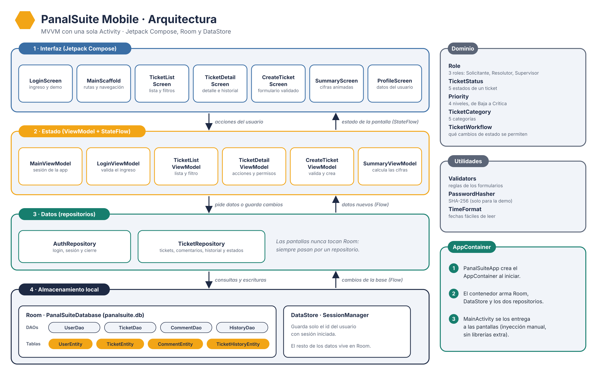
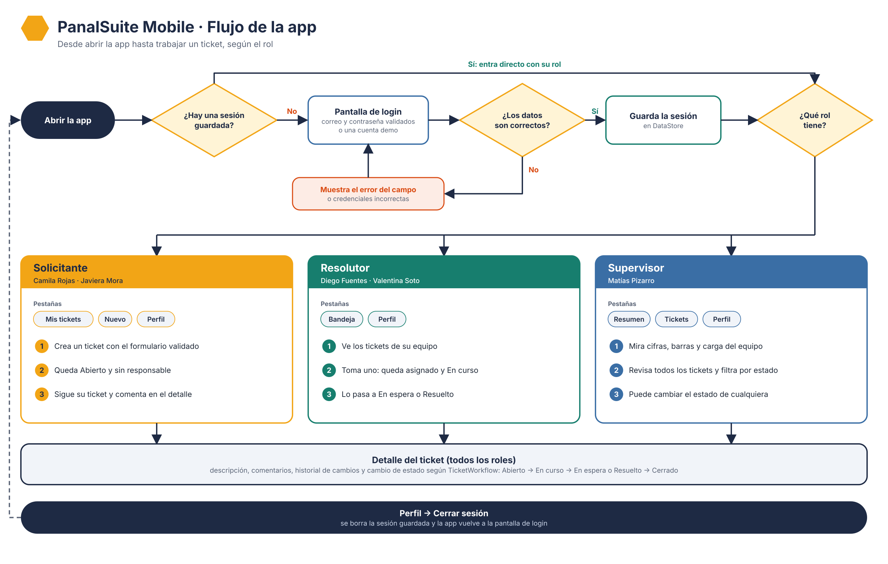

# PanalSuite Mobile

Aplicación Android para gestionar tickets de soporte interno de una empresa ficticia. Los **solicitantes** crean tickets, los **resolutores** los toman y los resuelven, y el **supervisor** ve cómo va la operación.

Proyecto académico (MVP) de **DSY1105 · Desarrollo de Aplicaciones Móviles**, Duoc UC, Parcial 2.
Todos los datos son ficticios y se guardan solo en el dispositivo: la app funciona sin conexión.

**Autores:** Ignacio Gonzalez · Victor Gutierrez

---

## Qué hace cada rol

| Rol | Pestañas | Qué puede hacer |
|---|---|---|
| Solicitante | Mis tickets · Nuevo · Perfil | Crear tickets con un formulario validado, seguir su estado y comentar. |
| Resolutor | Bandeja · Perfil | Ver los tickets de su equipo, tomar uno (queda asignado y En curso) y cambiar su estado. |
| Supervisor | Resumen · Tickets · Perfil | Ver cifras, barras animadas y carga del equipo; revisar todos los tickets y cambiar su estado. |

Todos los roles pueden abrir el detalle de un ticket (descripción, comentarios e historial de cambios) y cerrar sesión desde el perfil.

## Cuentas de prueba

Contraseña de todas las cuentas: **`Demo1234`**

| Nombre | Correo | Rol | Equipo |
|---|---|---|---|
| Camila Rojas | camila.rojas@panalsuite.test | Solicitante | Tiendas |
| Javiera Mora | javiera.mora@panalsuite.test | Solicitante | Farmacia |
| Diego Fuentes | diego.fuentes@panalsuite.test | Resolutor | Soporte TI |
| Valentina Soto | valentina.soto@panalsuite.test | Resolutor | Infraestructura |
| Matías Pizarro | matias.pizarro@panalsuite.test | Supervisor | Operaciones |

La pantalla de login tiene botones de acceso rápido para Camila, Diego y Matías. Al abrir la app por primera vez se cargan 7 tickets de ejemplo.

## Cómo ejecutarla

1. Abre el proyecto con una versión de Android Studio compatible con Android Gradle Plugin 9.3.
2. Espera a que termine la sincronización de Gradle.
3. Crea o elige un emulador con Android 8.0 (API 26) o superior.
4. Presiona **Run**.

Para volver a los datos de ejemplo, borra los datos de la app en el emulador: **Settings → Apps → PanalSuiteMobile → Storage & cache → Clear storage**.

## Cómo se cumplen los criterios de evaluación

| Criterio | Dónde se ve |
|---|---|
| Diseño visual | Tema propio (azul marino, ámbar y verde azulado), logo hexagonal, modo claro y oscuro, Material 3. |
| Formularios validados | Login, nuevo ticket y comentarios: errores por campo, contadores de caracteres y reglas en `util/Validators.kt`. |
| Navegación | Navigation Compose con barra inferior distinta por rol, pantalla de detalle con argumento y transiciones animadas. |
| Manejo de estado | ViewModel + StateFlow, con un estado de pantalla por ViewModel (`UiState`), leído con `collectAsStateWithLifecycle`. |
| Almacenamiento local | Room (4 tablas, con datos de ejemplo) y DataStore para la sesión. |
| Opcionales | Animaciones, código en inglés, diagrama de arquitectura y diagrama de flujo. |

### Reglas de los formularios

| Campo | Regla |
|---|---|
| Correo | Formato válido |
| Contraseña | Mínimo 8 caracteres |
| Título del ticket | De 5 a 80 caracteres |
| Descripción | De 10 a 500 caracteres |
| Sucursal | Mínimo 3 caracteres |
| Categoría | Obligatoria |
| Comentario | No vacío, máximo 300 caracteres |

### Estados de un ticket

| Estado actual | Puede pasar a |
|---|---|
| Abierto | En curso |
| En curso | En espera · Resuelto |
| En espera | En curso |
| Resuelto | Cerrado · En curso |
| Cerrado | Ninguno |

La regla vive en `domain/model/TicketWorkflow.kt` y cada cambio queda anotado en el historial del ticket.

## Arquitectura

MVVM con una sola Activity. Cada capa solo habla con la de abajo: las pantallas nunca tocan Room, siempre pasan por un repositorio. Las dependencias se arman a mano en `AppContainer`, sin librerías de inyección.



## Flujo de la app



## Estructura del código

```
app/src/main/java/com/panalsuite/mobile/
├── MainActivity.kt        Única Activity; muestra login o la app según la sesión
├── PanalSuiteApp.kt       Clase Application; crea el AppContainer
├── AppContainer.kt        Inyección manual de dependencias
├── data/
│   ├── local/             Room (entidades, DAOs, base), datos de ejemplo y DataStore
│   └── repository/        AuthRepository y TicketRepository
├── domain/model/          Roles, estados, prioridades, categorías y TicketWorkflow
├── ui/
│   ├── MainViewModel.kt   Estado de la sesión
│   ├── components/        Piezas reutilizables (logo, etiquetas, carga)
│   ├── navigation/        Rutas por rol y estructura de navegación
│   ├── screens/           login · tickets · create · summary · profile
│   └── theme/             Colores, tipografía y tema claro y oscuro
└── util/                  Validators, PasswordHasher y TimeFormat
```

## Tecnologías

| Tecnología | Versión |
|---|---|
| Kotlin | 2.2.10 |
| Android Gradle Plugin | 9.3.3 |
| Jetpack Compose (BOM) | 2026.02.01 |
| Navigation Compose | 2.9.8 |
| Lifecycle (ViewModel, StateFlow) | 2.11.0 |
| Room | 2.8.5 |
| DataStore Preferences | 1.2.1 |
| minSdk / targetSdk | 26 / 37 |

## Notas

- Las contraseñas se guardan con SHA-256 solo para esta demostración; una app real necesitaría un hash con sal y un servidor.
- Los textos de la interfaz están en español; el código (clases, funciones y variables) está en inglés.
- Los commits siguen Conventional Commits (`feat`, `fix`, `refactor`, `chore`, `docs`).
